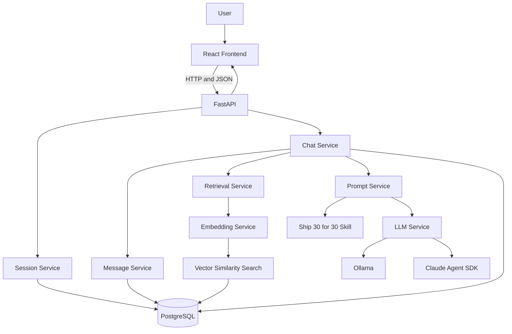
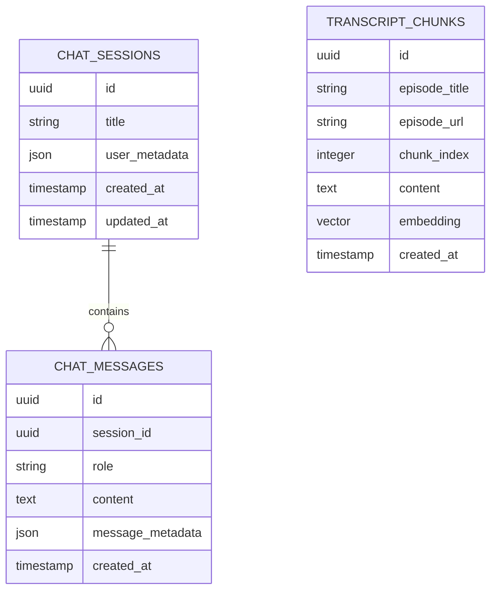
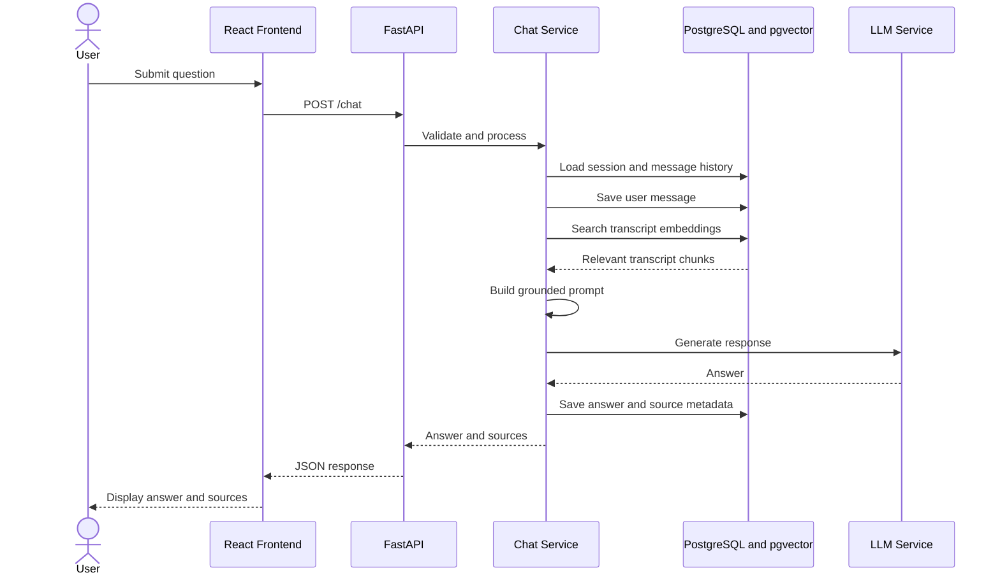
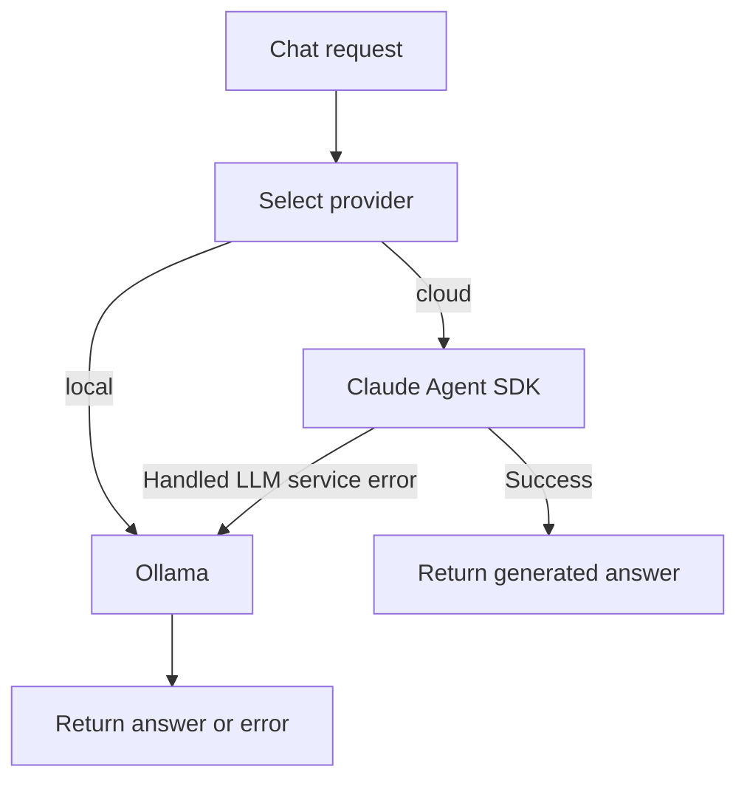

# Architecture Document — Lenny Growth Assistant

## 1. Overview

Lenny Growth Assistant is a full-stack application that answers questions using retrieved podcast transcript evidence.

The system separates the frontend, API layer, persistence, retrieval, prompt construction, and language-model generation into distinct responsibilities.

### Technology Stack

| Layer | Technology | Responsibility |
|---|---|---|
| Frontend | React | Chat interface, session navigation, provider selection, source viewing |
| API | FastAPI | HTTP endpoints and request validation |
| Persistence | PostgreSQL | Chat sessions, messages, and transcript chunks |
| Vector search | pgvector | Similarity search over transcript embeddings |
| Embeddings | sentence-transformers | Converts text into 384-dimensional vectors |
| Local generation | Ollama | Runs a locally available language model |
| Cloud generation | Claude Agent SDK | Provides the cloud generation path |
| Essay workflow | Python skill loader and Markdown skill | Supplies dedicated Ship 30 for 30 writing instructions |
| Configuration | Environment variables | Controls database, providers, models, and retrieval settings |

## 2. High-Level Architecture

The diagram represents the principal logical components. It does not imply that every request invokes the essay skill or both language-model providers.

## 3. Backend Organization

The backend is organized by responsibility.

### API Layer

The API layer exposes the application's HTTP interface and validates incoming requests.

Relevant modules include:
- `backend/app/main.py`
- `backend/app/api/schemas.py`
- `backend/app/api/chat_routes.py`
- `backend/app/api/session_routes.py`

The chat request includes a session identifier, a question, and an optional provider selection.

### Session Service

The session service creates sessions and retrieves existing sessions by identifier.

Session records provide the persistent identity needed to associate messages with a conversation.

### Message Service

The message service saves messages and retrieves a session's conversation history.

Messages include a role, content, timestamp, session association, and metadata. Assistant-message metadata can include retrieved source information.

### Chat Service

The chat service coordinates a request:

1. Validate that the question is not empty.
2. Verify that the requested session exists.
3. Load recent conversation history.
4. Save the user's question.
5. Retrieve relevant transcript chunks.
6. Return an evidence-limitation response if no chunks meet the retrieval criteria.
7. Otherwise, construct the prompt and request generation.
8. Save the assistant response and source metadata.
9. Return the answer and sources to the API layer.

The chat service is the orchestration point for retrieval and generation.

### Prompt Service

The prompt service combines the current question, conversation history, and retrieved transcript excerpts into a generation prompt.

The prompt requires factual grounding, inline source citations, and transparent handling of insufficient evidence. It also instructs the model to treat transcript content as untrusted data rather than as instructions.

When a supported Ship 30 for 30 request is detected, the dedicated essay skill is added to the prompt.

### Skill Service

`backend/app/services/skill_service.py` loads:

`backend/app/skills/ship_30_for_30/SKILL.md`

The loaded content is cached in process memory using `lru_cache`. The skill defines the essay-writing workflow; it does not replace retrieval or source-grounding requirements.

### LLM Service

The LLM service abstracts the generation provider.

**Local path**
- Sends a chat-generation request to the configured Ollama API.
- Uses the model specified by `OLLAMA_MODEL`.

**Cloud path**
- Uses the Claude Agent SDK.
- Requires a valid Anthropic API key.
- Uses a bounded agent configuration with no additional tools.

**Fallback**
- If cloud generation raises the handled `LLMServiceError`, the service attempts local Ollama generation.
- Fallback depends on the Ollama service and configured model being available.

## 4. Retrieval and RAG Pipeline

### 4.1 Ingestion

The transcript ingestion workflow prepares the available podcast transcripts for retrieval.

Conceptually, it performs these operations:

1. Read supported transcript files.
2. Split transcript text into chunks.
3. Generate embeddings for the chunks.
4. Store episode metadata, chunk content, and embeddings in PostgreSQL.

The exact ingestion command and implementation should be documented from the repository's ingestion code.

### 4.2 Embedding Generation

The embedding service uses the configured sentence-transformers model. The current configuration uses:

`sentence-transformers/all-MiniLM-L6-v2`

Embeddings are normalized and have 384 dimensions, matching the database vector column.

The same compatible embedding model must be used when indexing transcripts and embedding search queries.

### 4.3 Query Retrieval

For a question requiring transcript evidence:

1. The retrieval service embeds the question.
2. PostgreSQL and pgvector perform vector similarity search.
3. Candidate chunks are ranked by similarity.
4. The configured retrieval limit controls the number of candidates.
5. The service applies the similarity threshold.
6. The remaining chunks are passed to prompt construction.

The current retrieval threshold is `0.40`. This is a configurable quality trade-off, not a guarantee that every returned chunk is relevant.

If retrieval returns no chunks, the current chat flow returns a predefined response explaining that the available transcripts did not establish the requested information.

### 4.4 Grounded Generation

When evidence is available, the prompt contains the retrieved excerpts with source labels, episode titles, and URLs.

The model is instructed to:
- Support factual claims with source citations.
- Avoid inventing quotations and episode details.
- Disclose insufficient evidence.
- Treat transcript content as untrusted input.

Prompt instructions improve grounding but do not guarantee that every generated claim will be correct.

## 5. Data Model

The application uses PostgreSQL for persistent application and retrieval data.

### `chat_sessions`

Stores conversation sessions.

Principal data includes:
- UUID identifier.
- Session title.
- User metadata.
- Creation and update timestamps.

### `chat_messages`

Stores individual conversation messages.

Principal data includes:
- Message identifier.
- Associated session identifier.
- Role.
- Message content.
- JSON metadata.
- Creation timestamp.

The session association supports retrieval of messages belonging to a particular conversation.

### `transcript_chunks`

Stores transcript material for retrieval.

Principal data includes:
- Chunk identifier.
- Episode title.
- Episode URL.
- Chunk index.
- Transcript content.
- Vector embedding.
- Creation timestamp.

The embedding column uses pgvector with 384 dimensions.

### Data relationships

Transcript chunks are retrieved by similarity rather than through a direct foreign-key relationship to chat messages. Source metadata is associated with assistant messages so it can be retrieved when a conversation is reopened.

## 6. Request and Response Flow

A normal evidence-supported chat request follows this sequence:

When retrieval finds no qualifying chunks, the chat service follows its evidence-limitation path rather than invoking the generation service for that question.

## 7. Provider Routing

The frontend can request either `local` or `cloud`. If the provider is omitted, the backend uses the configured default.

The cloud-to-local fallback is implemented for the handled `LLMServiceError` path. It should not be interpreted as a guarantee that every possible cloud failure will be recovered.

## 8. Configuration and Secrets

Environment-based settings configure:
- Database connection.
- Default generation provider.
- Ollama API address and model.
- Anthropic API key.
- Embedding model.
- Retrieval limit.
- Frontend origin.

Secrets must remain in the server environment and must not be committed to the repository or exposed to the frontend.

The `.env.example` file should contain placeholder values rather than working credentials.

## 9. Deployment Considerations

A deployment requires:
- A Python environment with the backend dependencies.
- A reachable PostgreSQL instance with pgvector enabled.
- Initialized application tables and ingested transcript embeddings.
- A configured generation provider.
- A frontend build configured to call the deployed backend.
- Appropriate CORS, environment variables, and network access.

Ollama normally runs on a separate local or hosted machine. A public backend cannot use a developer's `localhost` Ollama endpoint as though it were a publicly reachable model service.

For public deployment, the backend needs a reachable inference endpoint or a configured cloud provider. If using a managed PostgreSQL provider, verify pgvector support and connection limits.

## 10. Security and Operational Boundaries

- Keep credentials server-side.
- Validate API inputs and handle missing sessions.
- Treat transcript excerpts as untrusted input.
- Sanitize or isolate generated HTML before rendering it.
- Avoid logging secrets or full sensitive prompts.
- Configure production CORS for the actual frontend origin.
- Use appropriate request timeouts and error handling.
- Do not expose database credentials or internal service addresses to the browser.

These are operational requirements; deployment-specific controls must be configured and verified separately.

## 11. Known Limitations

- Retrieval quality depends on transcript coverage, chunking, embeddings, and the similarity threshold.
- LLM output may still contain unsupported claims despite grounding instructions.
- Local response latency depends on the selected model and available hardware.
- Cloud fallback depends on local inference availability.
- The application does not establish user authentication or multi-tenant isolation merely by storing session identifiers.
- Production availability, scalability, and security depend on deployment configuration and operational testing.
